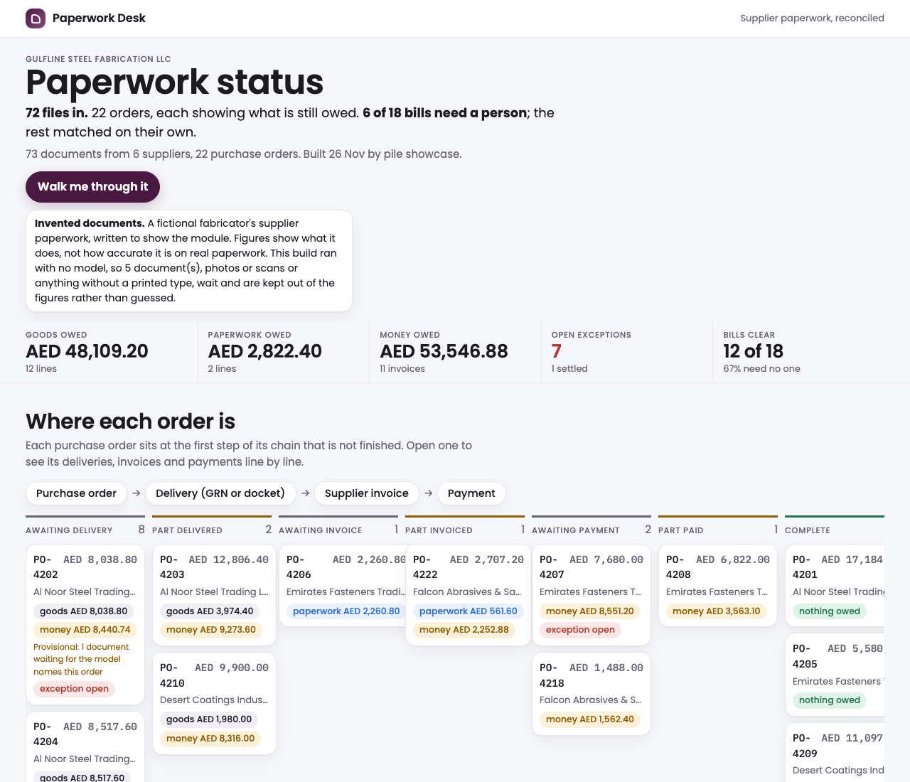
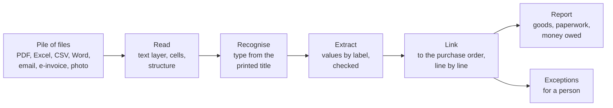
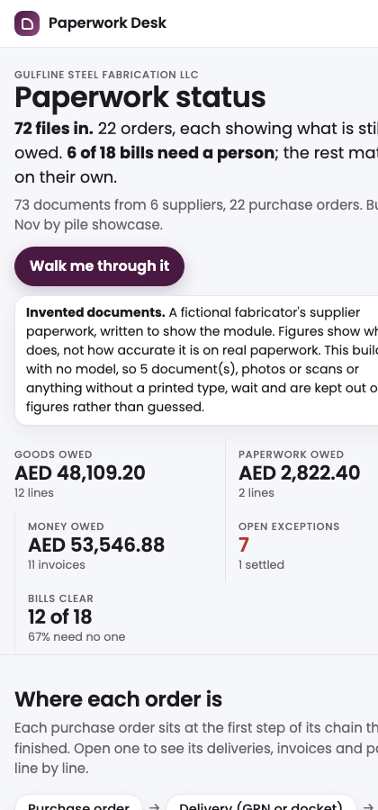

# Paperwork Desk

**Supplier paperwork, reconciled.** Drop in a pile of purchase orders, delivery dockets, invoices, credit notes, statements and remittances, in any format. Get back, for every order, what is still owed and the few items that need a person.

**Live demo:** [UAE (AED, VAT)](https://yousufagha.github.io/pile-showcase/) · [India (INR, GST)](https://yousufagha.github.io/pile-showcase/in/)

All companies, documents and figures in the demo are invented.

## What it answers

For every purchase order, three questions:

| Owed | Means | Example from the demo |
|---|---|---|
| **Goods** | Ordered, not yet delivered | PO-4204: 2.1 t of 12 mm plate, AED 8,517.60 still to arrive |
| **Paperwork** | Delivered, not yet invoiced | PO-4206: 120 chemical anchors received, no invoice yet |
| **Money** | Invoiced, not yet paid | BF-INV-31131: AED 3,563.10 left after a part payment |

Anything that does not reconcile becomes an exception, explained in plain words with the money at stake.

## The demo in five steps

Open the [demo](https://yousufagha.github.io/pile-showcase/) and press **Walk me through it**.

1. **Drop in the pile.** 72 files: PDFs, spreadsheets, emails, e-invoices, photos. No sorting, no naming rules. Each file is sorted by what it says.
2. **Every value has evidence.** A value is taken only where it is printed next to its label, then the totals and VAT are checked. Nothing is guessed.
3. **Where every order is.** Each purchase order sits on a board by stage, showing what is still owed on it.
4. **Only what needs a person.** Anything that does not reconcile becomes a card with the money at stake and a suggested fix.
5. **The result.** The share of bills needing a person, week by week. In the demo, 6 of 18 bills need a person; the rest matched on their own.

The page opens on a simple view. **Show the full detail** adds how each document was read, accuracy figures, owed by supplier, freight, proposed journals and every document.

## How it works

1. **Read.** Most supplier paperwork already carries its text as data, so it is read directly: a PDF's text layer word by word, spreadsheet cells, Word tables, email attachments, Peppol e-invoice fields.
2. **Recognise.** The document type comes from its printed title (Tax Invoice, Delivery Note, Statement), never from the file name. Multi-document PDFs are split, and a page 2 that arrived alone is joined to its page 1.
3. **Extract.** Values are found by their labels, not fixed positions, so a supplier never seen before is still read with no template. Lines must multiply out, totals add up, and tax match the local rate and tax-invoice rules.
4. **Link.** Each delivery, invoice, credit and payment finds its order. Each line finds its order line by item code, steel section (310UB46 is UB 310x46) or description, with units converted.
5. **Report.** Each order's stage and what is owed, plus exceptions: price or quantity variance, missing delivery, no matching order, duplicate, or a bill on the supplier's statement that never arrived.

## The rules it keeps

- **The model reads; it never decides.** An AI model is used only to read photos and scans. Every match, sum, link and verdict is ordinary code that can be audited line by line.
- **Nothing is guessed.** A value is accepted only with evidence: printed next to its label, matched to the supplier list, a structured e-invoice field, or, for a photo, read the same by two different models. Anything else is left blank or held for review.
- **Every decision is kept.** Approvals, rejections and tolerance rules are recorded with who made them and when.
- **Nothing is posted.** It proposes balanced journal entries for the accounting package; a person posts them.

## Results so far

Scored against answer keys on test packs, run without the AI model (so photos and scans count as misses):

| Pack | Documents found | Header values right | Line values right | Values accepted as fact |
|---|---|---|---|---|
| September, UAE (73 documents) | 73 of 73 | 99.0% | 97.2% | 466, none wrong |
| September, India (73) | 73 of 73 | 98.3% | 97.2% | 504, none wrong |
| September, Australia (73) | 72 of 73 | 97.3% | 97.2% | 467, none wrong |
| Public sample invoices (13, real) | 13 of 13 | 59.0% | 12.8% | 9, none wrong |

The test packs were written to test the module, so they show how it behaves, not how accurate it is on real paperwork. The public invoices are real but foreign layouts: most of their values are held rather than guessed, which is the point.

## Countries

The country is a setting per pile: currency, tax, the supplier's tax number and the tax-invoice rules.

| Country | Currency | Tax | Supplier tax number |
|---|---|---|---|
| UAE | AED | VAT 5% | TRN |
| India | INR | GST (CGST and SGST, or IGST) | GSTIN |
| Australia | AUD | GST 10% | ABN |

## On your own files

A trial link reads your own files and shows the same page for them: choose your country, then upload files, a folder or a .zip. Files are deleted before the results come back, and no AI service sees them. The link is shared on request.

## Built with

Python 3.12 as a plain library with a command line, so it can sit inside a host system whatever its stack: pdfplumber and pypdf for PDFs, openpyxl, python-docx and lxml for the other formats, SQLite for the document ledger, Flask for the upload link. 193 tests. The demo is one self-contained HTML page; its only outside request is for web fonts.

This repository holds the demo only; the module's source is private.
